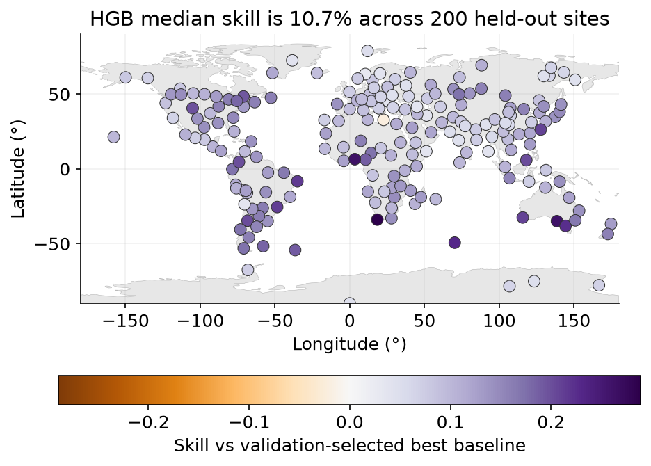
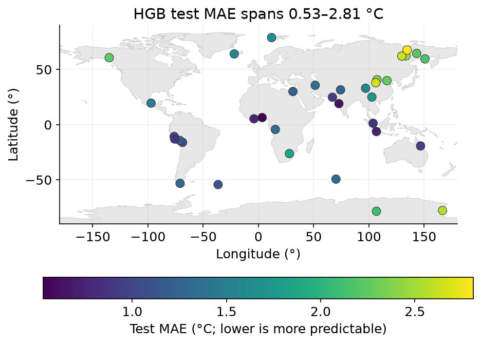
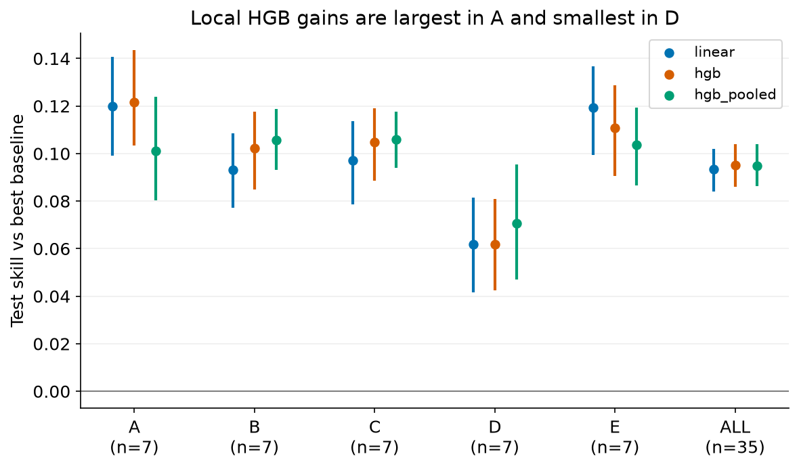
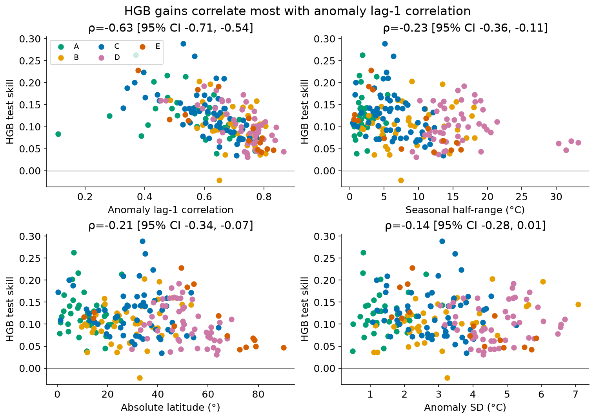

# Skillmap

**Where in the world is weather predictable, and where does machine learning actually beat simple rules?**

Skillmap forecasts tomorrow's high temperature (Tmax) at 200 sites spread across 29 of the 30 Köppen climate
classes, using 11 years of daily ERA5 data (2015–2025). Two simple rules serve as baselines:

- **Persistence:** tomorrow equals today.
- **Climatology:** the seasonal average for that date.

These are compared with three models: per-site ridge regression, per-site gradient boosting, and one gradient
boosting model pooled across all sites. Every model is scored on 2024–2025, two held-out years it never saw
during training or tuning.

Short answer:

- **Machine learning beats the better simple rule almost everywhere, but only by about 10%.**
- **Persistence is a much harder baseline than climatology.** Comparing against climatology alone would make
  ML look three times as useful.
- **Predictability varies about tenfold**, from 0.3 °C typical error in tropical island climates to 3.4 °C on
  the Canadian prairies.



## Findings

All numbers below come from [`findings.json`](data/processed/findings.json),
[`skill_site.csv`](data/processed/skill_site.csv) and [`skill_group.csv`](data/processed/skill_group.csv),
for the 2024–2025 test period. MAE is mean absolute error in °C.

Skill is `1 − MAE_model / MAE_baseline`; 10% means the model's typical error is 10% smaller. The baseline is
the better of persistence and climatology, chosen per site using only the 2022–2023 validation years.

**1. ML wins at almost every site, by a modest margin.**

| Model | Median skill (IQR) | Sites with 95% CI above zero | Mean test MAE |
|---|---:|---:|---:|
| Ridge regression | 10.3% (7.0–12.6%) | 191/200 | 1.667 °C |
| Gradient boosting (HGB), per site | 10.7% (7.8–14.2%) | 191/200 | 1.641 °C |
| Gradient boosting, pooled across sites | 10.0% (8.0–13.0%) | 190/200 | 1.653 °C |
| *Persistence* | | | *1.860 °C* |
| *Climatology* | | | *2.554 °C* |

No model is significantly worse than the baseline at any site. Only one site has negative point skill for
HGB: Darnah, Libya, at −2.2% (95% CI −9.4% to +4.0%), which is within noise.

**2. Persistence is the baseline to beat.**

- Persistence has lower test MAE than climatology at 189 of 200 sites, and was selected on validation at 186.
- Against climatology alone, HGB's median skill would be 33.8%, more than three times the honest figure.
- Most of the "easy" improvement comes from simply using yesterday's temperature.

**3. Predictability varies about tenfold.**



- Most predictable: tropical maritime sites, e.g. Port Blair (Am, HGB MAE 0.30 °C) and Malé (Am, 0.31 °C).
- Least predictable: mid-latitude continental interiors, e.g. Regina (Dfb, 3.44 °C), Lethbridge (BSk,
  3.41 °C) and Edmonton (Dfb, 3.17 °C).

**4. Where ML helps most depends on how you measure.**



| Climate group | Sites | Best-baseline MAE | HGB MAE | HGB skill (95% CI) |
|---|---:|---:|---:|---:|
| A tropical | 35 | 0.95 °C | 0.83 °C | 13.1% (12.2–14.0%) |
| B arid | 40 | 1.76 °C | 1.56 °C | 11.6% (10.6–12.4%) |
| C temperate | 60 | 1.82 °C | 1.59 °C | 12.8% (12.0–13.5%) |
| D continental | 50 | 2.59 °C | 2.32 °C | 10.5% (9.6–11.3%) |
| E polar | 15 | 1.89 °C | 1.71 °C | 9.6% (8.5–10.8%) |

- In relative terms, ML gains most in tropical (A) and temperate (C) climates.
- In absolute terms, continental (D) climates gain most: 0.27 °C versus 0.12 °C for tropical.
- Group values weight sites equally. Intervals resample the same date blocks across all sites in a group.

**5. The strongest driver of ML gain is how persistent temperature anomalies are.**



- The site's lag-1 autocorrelation of temperature anomalies, measured on training years, has a Spearman
  correlation with HGB skill of ρ = −0.63 (site-bootstrap 95% CI −0.71 to −0.54).
- Where today's departure from normal tends to carry over to tomorrow, persistence is already good and leaves
  little room. Where anomalies flip quickly, lagged weather variables add more.
- Seasonal range (ρ = −0.23) and absolute latitude (ρ = −0.21) are weaker.
- These are exploratory associations with no multiple-testing adjustment, not causal effects.

**6. Model complexity matters less than inputs.**

- **HGB vs ridge:** HGB beats ridge at 132 of 200 sites, but mean MAE differs by only 0.026 °C.
- **Pooled model:** pooling all sites into one gradient-boosting model, with site descriptors, did not help.
  It beats the per-site model at 73 of 200 sites and is 0.012 °C worse on average.
- **Extra weather inputs:** adding humidity, pressure and wind lags to temperature and calendar features lowers
  mean MAE for every model: by 0.080 °C for HGB, 0.060 °C for ridge and 0.052 °C for pooled HGB
  ([ablation figure](reports/figures/ablation.png)).

More figures: [seasonal skill](reports/figures/seasonal.png), [per-site MAE against
baseline](reports/figures/baseline_vs_model.png), and [example forecasts at the best and worst
sites](reports/figures/example_city.png). The three [executed notebooks](notebooks/) walk through the data,
the models and the geographic comparison.

## Method

**Sites.**

- 200 sites are sampled from GeoNames cities and 12 candidate research stations, stratified by the Beck et al.
  (2023) 1 km Köppen–Geiger map for 1991–2020. Quotas: A 35, B 40, C 60, D 50, E 15.
- Every class with candidates gets at least two sites. Csc has only one candidate, and Dsd has none.
- Remaining slots go to geographically spread sites, at least 250 km apart (relaxed only where needed). Each
  site gets its own ERA5 grid cell, with at most 12 per country.
- The result: 192 cities and 8 research stations (including Vostok, South Pole and Summit, Greenland) in 92
  countries.

**Data.**

- Daily maximum and minimum temperature, mean relative humidity, mean sea-level pressure and mean 10 m wind
  speed from the Open-Meteo archive API (ERA5).
- Dates are local calendar days, 2015-01-01 to 2025-12-31: 803,600 site-days with no missing values.

**Forecast timing (no leakage).**

- Predictors for target date *d* use data from *d − 1* or earlier, plus the calendar day of *d*.
- Features: lags 1–7 of all five variables, pressure tendency, yesterday's daily temperature range,
  day-of-year terms, and yesterday's Tmax anomaly.
- Climatology (three annual harmonics), imputers and scalers are fit only on the training rows of each fold.

**Splits.** Splits are chronological and shared by all sites.

| Split | Years | Use |
|---|---|---|
| Train | 2015–2021 | Fit models |
| Validation | 2022–2023 | Pick hyperparameters and each site's baseline |
| Test | 2024–2025 | Refit on train + validation, then evaluate once |

**Models.**

- Ridge regression and scikit-learn's `HistGradientBoostingRegressor` with absolute-error loss.
- Hyperparameters are shared across sites and chosen on mean validation MAE:
  - Ridge: alpha 10.
  - Per-site HGB: 400 iterations, 7 leaves.
  - Pooled HGB: 400 iterations, 15 leaves. It predicts the anomaly from climatology and adds site latitude,
    elevation, Köppen group and the climatological value as features.
- All three selections sit on a grid edge (ridge's upper alpha, HGB's lower leaf count, pooled's upper
  iteration count). The validation differences are small: ridge's MAE changes by 0.0015 °C across a
  10,000-fold alpha range.

**Uncertainty.**

- Paired moving-block bootstrap over dates: 14-day blocks, 1,000 replicates.
- Model and baseline errors are resampled together, so intervals reflect the difference between them.
- Intervals are conditional on the selected models and do not include model-selection uncertainty.

The full specification is in the [data contract](contracts/README.md).

## Concurrent download

Each site-year is one request, but Open-Meteo counts it as about 13 weighted calls (5 variables × 365 days).
The 2,200 site-years (200 sites × 11 years) therefore come to roughly 28,700 weighted calls, against a
free-tier limit of 10,000 per day.

The downloader in [`fetch.py`](src/skillmap/fetch.py) works within those limits:

- A thread pool shares one rate limiter with sliding minute, hour and day windows, set below the free-tier limits.
- A rate-limit (HTTP 429) response pauses every thread at once.
- Downloads go to a resumable on-disk cache with atomic writes.
- A ledger of completed chunks restores the rate windows after a restart.

The full download ran over several days and resumed cleanly after interruptions. A one-time benchmark of
48 fresh requests measured:

| Threads | Seconds | Speedup |
|---:|---:|---:|
| 1 | 10.42 | 1.0× |
| 2 | 4.74 | 2.2× |
| 4 | 2.56 | 4.1× |
| 8 | 1.47 | 7.1× |

The production run used 4 threads, because the daily limit, not latency, sets the overall pace.

## Limitations

- **ERA5 is reanalysis, not station observations.** Its ~25 km grid smooths mountains and coastlines, so
  errors here are not what a thermometer at the city would show.
- **This is a retrospective study, not an operational forecast.** ERA5 arrives about five days late, and real
  forecasts use numerical weather prediction, which these models do not try to replace.
- **Sites are stratified by climate class**, not by area or population. "ALL" averages describe this sample,
  not the globe. Rare classes are thin (Csc has one site), and Dsd is absent.
- **Daily inputs only.** Sub-daily or upper-air data, which real forecasters use, could change the
  results.
- **Only two test years** (2024–2025). Skill may differ in other years.
- **Driver analysis is exploratory.** The listed explanations for weak sites are hypotheses.

## Reproduce

Requires Python 3.12+. Network access is needed only for the download step.

```bash
uv venv && uv pip install ".[prep,dev]"
python -m scripts.build_sites        # needs GeoNames and Köppen files in data/raw/ (see DATA_SOURCES.md)
python -m scripts.download           # resumable; about 4 days at the default daily cap
python -m scripts.build_dataset
SKIP_INPUTS=1 bash scripts/run_all.sh   # experiment, analysis, figures, app data, notebooks
```

The full experiment took 27.2 minutes with 8 parallel jobs. Every step after the download also runs on
synthetic data, with no network access:

```bash
python scripts/run_experiment.py --synthetic --out data/synthetic_run
```

The app reads only the small exported Parquet files in `app/data/`:

```bash
streamlit run app/streamlit_app.py
```

Tests and lint run with `bash scripts/check.sh` (ruff and 75 pytest tests, including headless Streamlit
`AppTest` runs). CI runs them on Python 3.12 and 3.14.

## Layout

```
src/skillmap/   config, sites, fetch, dataset, features, baselines, models, evaluate, bootstrap, analysis
scripts/        command-line steps (build_sites, download, build_dataset, run_experiment, analysis, ...)
app/            Streamlit app and exported data
data/processed/ sites, daily table, predictions, metrics, skill tables, findings
notebooks/      executed analysis notebooks
reports/        figures and the concurrency benchmark
contracts/      data contract: file formats, timing rule, split semantics
```

## Data and license

Code is MIT-licensed. Weather data by [Open-Meteo.com](https://open-meteo.com/) (ERA5, Copernicus/ECMWF),
CC BY 4.0. Köppen–Geiger classes from Beck et al. (2023), CC BY 4.0. Places from GeoNames, CC BY 4.0. Full
attribution is in [DATA_SOURCES.md](DATA_SOURCES.md).
